<div align="center">

# MALCOLM — Autonomous Clinical Triage & Ward Copilot

**Voice-First Clinical RAG • Touchless 3D Hand-Gesture Navigation • Real-Time Bedside Telemetry & Code Blue Crash Cart Dispatch • Zero-Leak PII Pseudonymization**

[](https://www.python.org/)
[](https://vitejs.dev/)
[](https://ai.google.dev/)
[](https://developers.google.com/mediapipe)
[](#privacy-first-pii-pseudonymization--re-hydration-pipeline)

</div>

---

## Overview

**Malcolm** is a dual-portal, voice- and gesture-controlled clinical triage copilot and bedside telemetry system built for high-acuity hospital wards. Inspired by a calm, British Jarvis-style clinical assistant (`en-GB-RyanNeural`), Malcolm bridges the **Attending Physician's Communication Portal** and the **Patient Bedside Monitor** over a real-time, thread-safe clinical state engine:

1. **Doctor Communication Portal (`http://localhost:8080`)** — Full-screen harmonic wave and radial sunburst interface that transitions into a `38vw / 62vw` split-screen clinical workstation. Supports continuous Speech-to-Text (`CLINICIAN STT`), neural Text-to-Speech, touchless webcam hand gestures (`[G]`) for sterile/gloved operation, live patient admission/discharge CRUD, ward telemetry statistics, PC-clock-synced shift timetables with hospital PA loudspeaker paging, and one-command plain-white `.xlsx` and `.png` exports.
2. **Patient Bedside Monitor (`http://localhost:5000`)** — Emerald-green telemetry display with an 8-layer translucent wave canvas, 40-blade radial sunburst ring, and PQRST ECG trace that dynamically shifts colors across **4 heart-rate severity tiers** (`Normal` Emerald Green $\rightarrow$ `Elevated` Amber $\rightarrow$ `High` Red with automatic Doctor Paging $\rightarrow$ `Critical` Flashing Crimson Code Blue Siren with Crash Cart dispatch and physical team stabilization acknowledgment), alongside hands-free patient voice check-ins.
3. **Zero-Leak PII Pseudonymization Engine (`local_rag.py`)** — Strips all patient names, room numbers, and identifiers into anonymized tokens (`[PATIENT_1429]`, `[LOCATION_1429]`) *before* any cloud LLM inference, then re-hydrates them locally on the hospital edge node—with a 100% deterministic offline RAG fallback if internet connectivity drops.

---

## Visual Tour & Interface Gallery

### 1. Doctor Communication Portal — Idle Standby (`At your Service`)
When in standby, Malcolm renders an 8-layer deep-blue harmonic wave canvas and a 40-blade radial sunburst ring while listening for wake commands or touchless hand gestures.

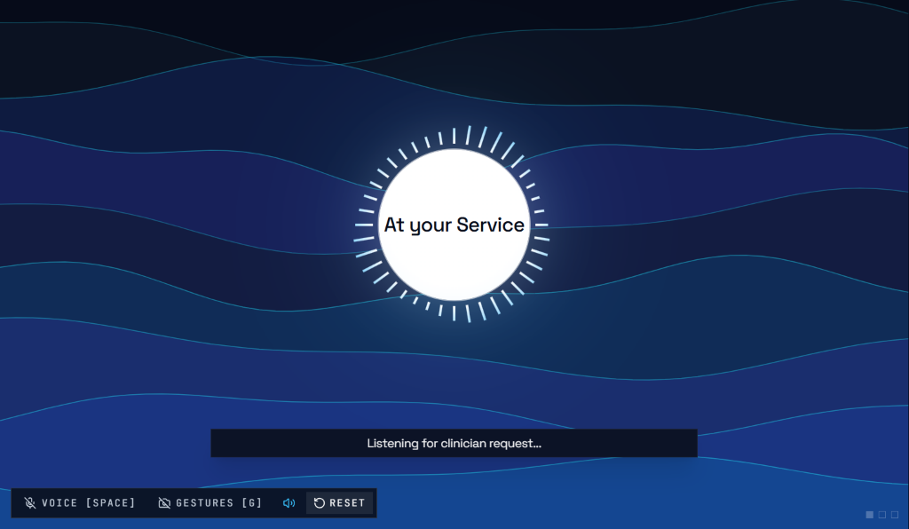

---

### 2. Split-Screen Patient Vitals & 4-Zone Clinical Chart (`38vw / 62vw`)
Asking *"Malcolm, give me the status of patient 1429"* and confirming check-in transitions the left canvas into a crimson BPM-locked heartbeat ring with a live PQRST ECG sweep (`38vw`), while sliding open the RAG-synthesized 4-zone clinical chart (`62vw`) covering **Department & Protocol**, **Live Telemetry State**, **Previous Nurse Rounds**, and **Patient-Reported Live Check-In Symptoms**.

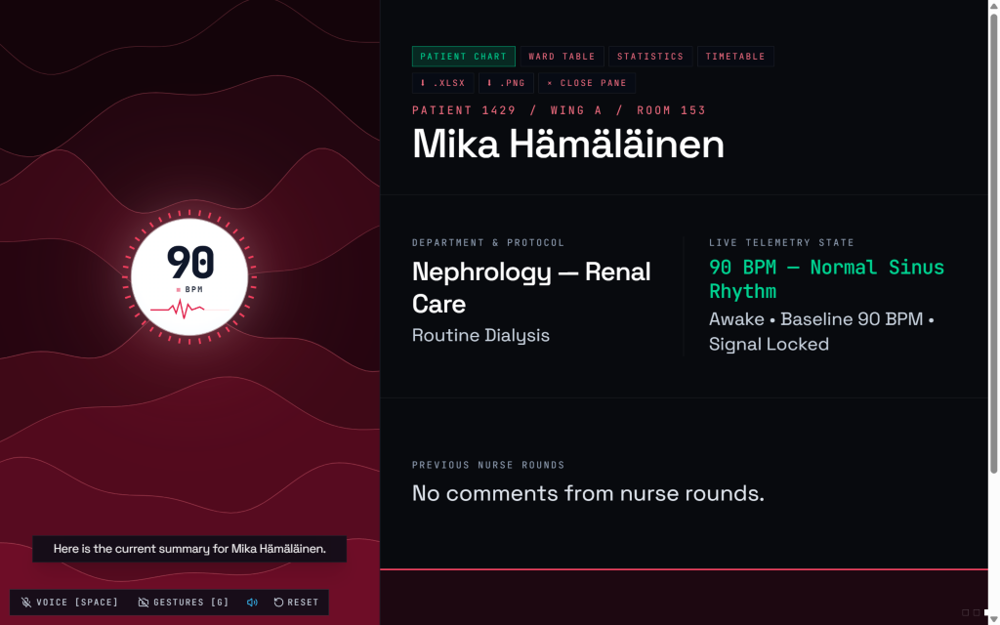

---

### 3. Active Ward Roster Table & Live Patient Admission / Discharge CRUD
Asking *"Show me a table of all patients on the ward"* opens the native **Active Ward Roster** (`<WardTableView />`) while keeping the left ring in calm blue standby. Clinicians can filter by hospital wing (`ALL`, `WING A`, `WING B`, `WING C`), click any row to inspect a patient's chart, or **Admit / Discharge patients** either via the UI (`+ ADMIT PATIENT` / `DISCHARGE`) or purely by voice:
- *"Add a new patient named John Doe in Wing B Room 210 with chest pain at 96 BPM."*
- *"Discharge John Doe from the ward."*

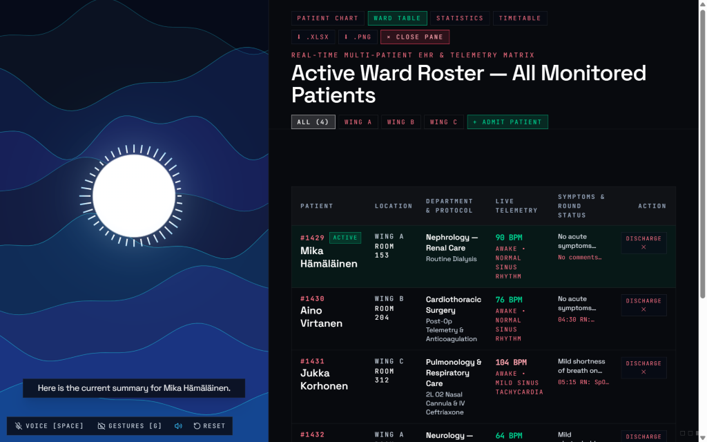

---

### 4. Ward Telemetry & Acuity Statistics
Asking *"Pull up the ward telemetry statistics"* renders real-time KPI cards (**Mean Heart Rate**, **BPM Range & Spread**, **Wakefulness State**, and **Acuity & Triage**) and interactive per-patient BPM distribution bars scaled across `40–140 BPM`.

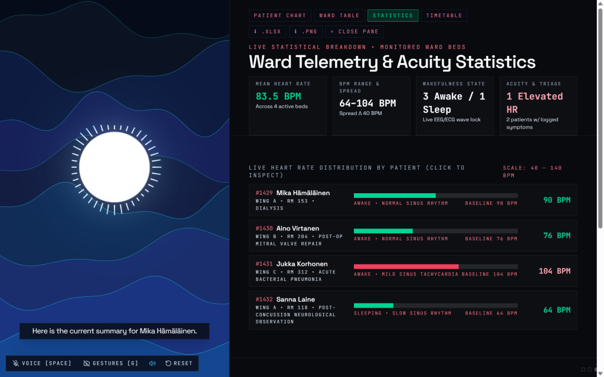

---

### 5. Clinician Shift Timetable & Hospital Loudspeaker Pager
Synced to the host PC's real system clock, the **Clinician Shift Timetable** arms the hospital PA loudspeaker (`winsound` + browser audio) to page the attending physician **5 minutes prior** to scheduled surgeries and check-ins, or on exact relative countdowns (*"Page me in 10 seconds"*).

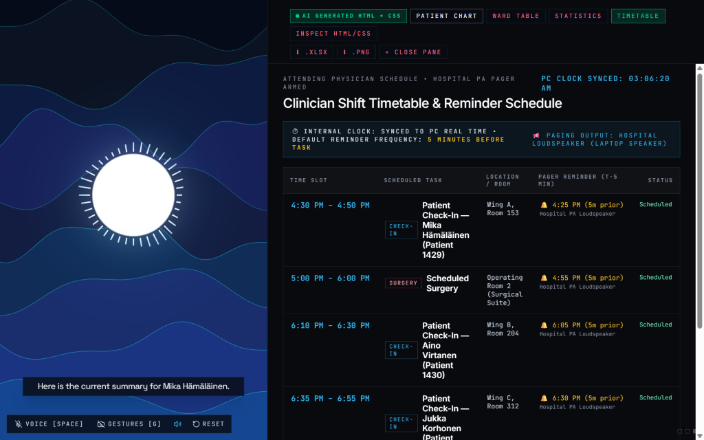

---

### 6. Plain-White Formatted `.PNG` & `.XLSX` Clinical Exports
Saying *"Export this as a PNG and XLSX"* (or clicking **`.XLSX`** / **`.PNG`** in the pane header) renders the active clinical table or statistics summary onto a high-contrast, print-ready `#FFFFFF` plain-white background and triggers an immediate browser download.

| Shift Timetable Export (`.png`) | Active Ward Roster Export (`.png`) | Ward Telemetry Statistics Export (`.png`) |
| :---: | :---: | :---: |
| 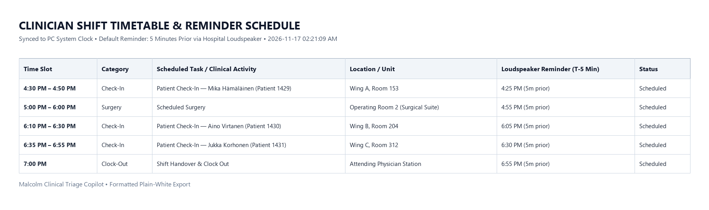 | 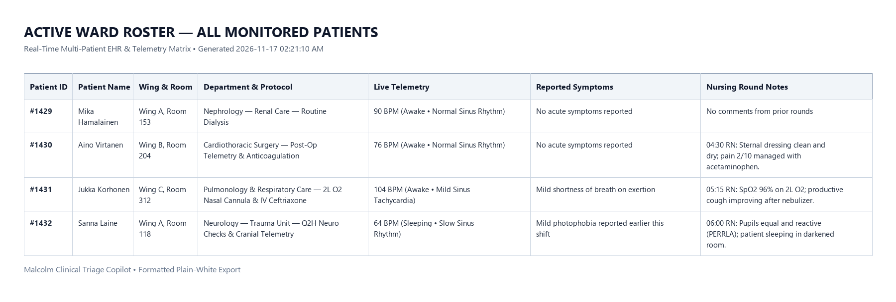 | 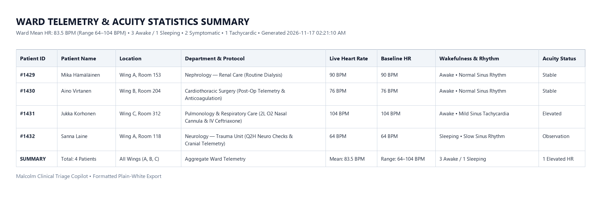 |

---

## Touchless Camera Hand-Gesture Navigation (`[G]`)

Designed for sterile surgical and ICU environments where clinicians cannot touch a keyboard or mouse, pressing **`G`** (or clicking **`GESTURES [G]`**) opens the real-time **MediaPipe 21-Point 3D Hand Skeleton HUD** in the bottom-left corner.

| Gesture | Hand Pose / Motion | Clinical Action | Live Demo (`.gif`) |
| :--- | :--- | :--- | :---: |
| **Silent Voice Trigger** | **Open Hand (`5 Extended Fingers`)** held steady | Immediately activates the microphone (`LISTENING...`) with **zero TTS self-interruption** | 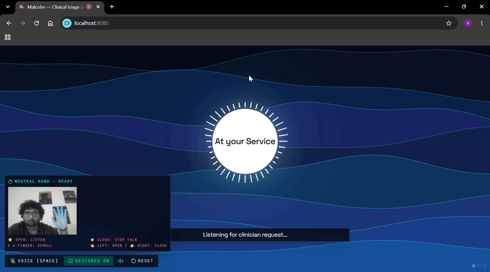 |
| **Hard Speech Mute & Mic Cancel** | **Closed Fist (`0 Extended Fingers`)** | Instantly halts Malcolm mid-sentence (`stopAllSpeech()`) and discards any partial mic recording (`POST /api/mic/stop?discard=1`) | 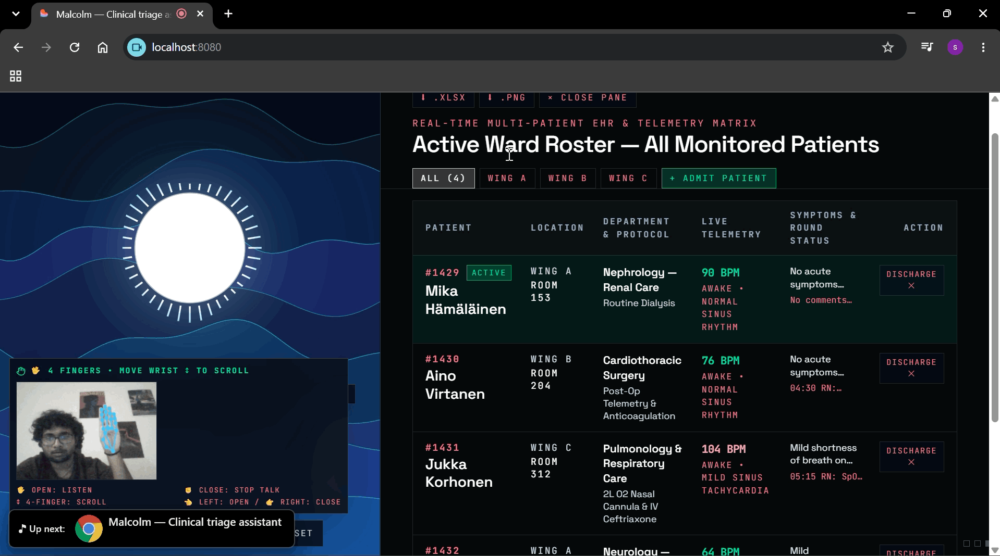 |
| **Touchless Pane Open / Close** | **Move Hand Left** (when closed) / **Swipe Right** (when open) | Slides the `62vw` clinical right-hand pane open or closed with a `1.8s` state-poll lock | 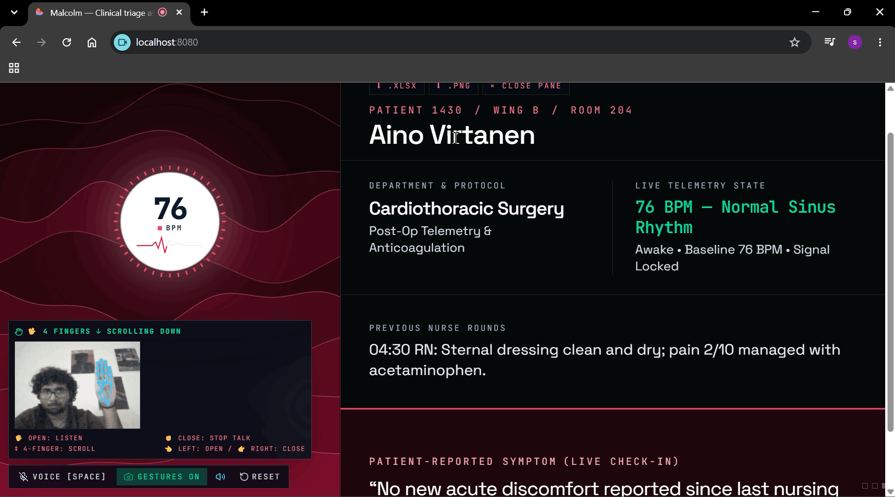 |
| **Proportional Vertical Scroll** | **4 Fingers Extended (Thumb Tucked)** + move wrist Up/Down | Smoothly scrolls the active right-hand clinical pane, ward table, or timetable | 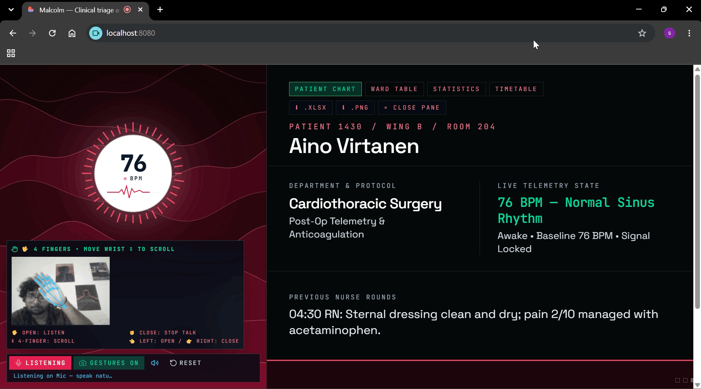 |

### Anti-Interference Engineering Highlights
- **3D Curl Ratio + 7-Frame Sliding Majority Window**: Evaluates fingertip-to-wrist vs. MCP/PIP distances in 3D space across a 7-frame sliding window with a wrist-velocity gate (`wristSpeed < 0.020`) so resting or transitioning hands stay in `NEUTRAL` and never false-trigger `CLOSED HAND (MUTE)` or `OPEN HAND (LISTEN)`.
- **Monotonic `replySeq` Guard**: Every clinician turn, bedside check-in, and emergency page increments an atomic `reply_seq` counter in `state_manager.py`, preventing stale 1-second state polls from re-triggering speech after a fist-mute.

---

## Patient Bedside Monitor & 4-Tier Code Blue Escalation (`http://localhost:5000`)

The **Patient Bedside Monitor** (`templates/bedside.html`) shares the Doctor Portal's wave-ribbon and 40-blade radial sunburst architecture, themed in **Emerald Green** for calm bedside visibility and equipped with automatic 4-tier heart-rate severity transitions:

| Severity Tier | Heart Rate Range | Visual Theme | Automated Clinical & Paging Action |
| :--- | :---: | :--- | :--- |
| **1. Normal** | `< 100 BPM` | **Emerald Green** (`#34d399`) | Calm harmonic wave & normal sinus rhythm telemetry (`SIGNAL LOCKED / NORMAL`) |
| **2. Elevated** | `100 – 114 BPM` | **Amber** (`#fbbf24`) | Visual border & disc transition to Amber (`ELEVATED HEART RATE`) |
| **3. High Alert** | `115 – 144 BPM` | **Red / Rose** (`#fb7185`) | Displays `HIGH BPM DETECTED — ATTENDING DOCTOR PAGED` banner and pages the Doctor Portal via loudspeaker |
| **4. Critical Code Blue** | `>= 145 BPM` | **Flashing Crimson** (`#ff2e4c`) | Triggers continuous **Code Blue Alarm Siren**, demands a **Crash Cart** to the patient's room on the Doctor Portal, and surfaces the **`CRASH CART TEAM: PUSH TO DISABLE ALARM & STABILIZE`** button |

| Normal Emerald Green (`76 BPM`) | High BPM Alert (`128 BPM`) | Critical Code Blue & Crash Cart (`168 BPM`) |
| :---: | :---: | :---: |
| 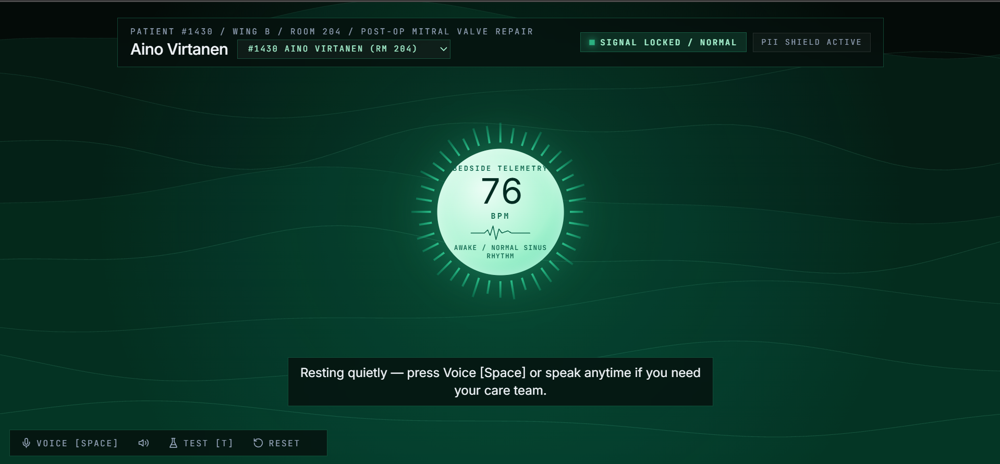 | 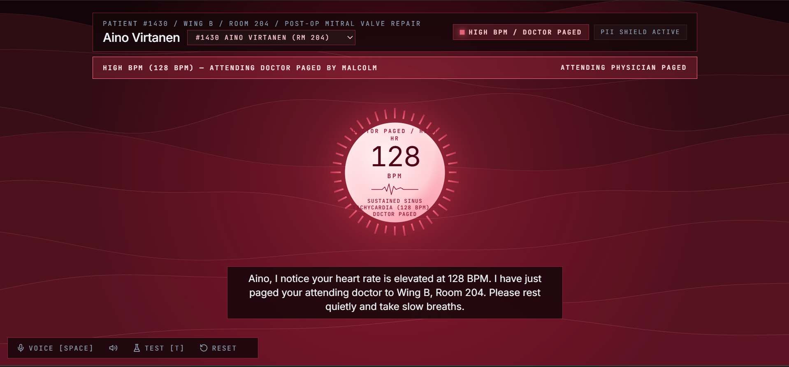 | 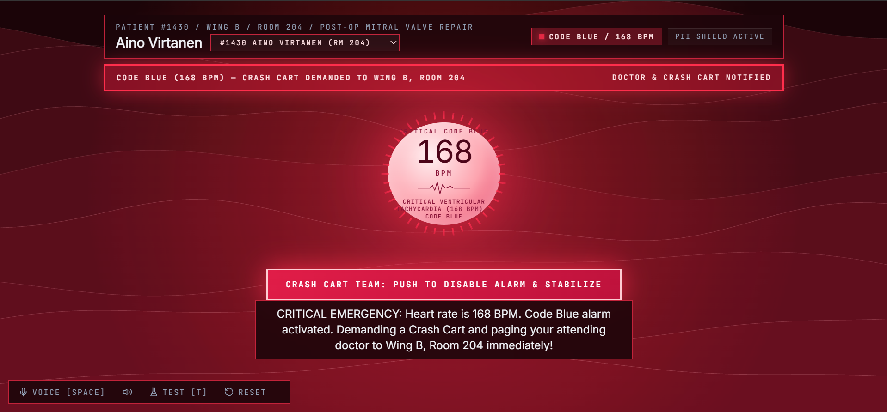 |

---

## System Architecture

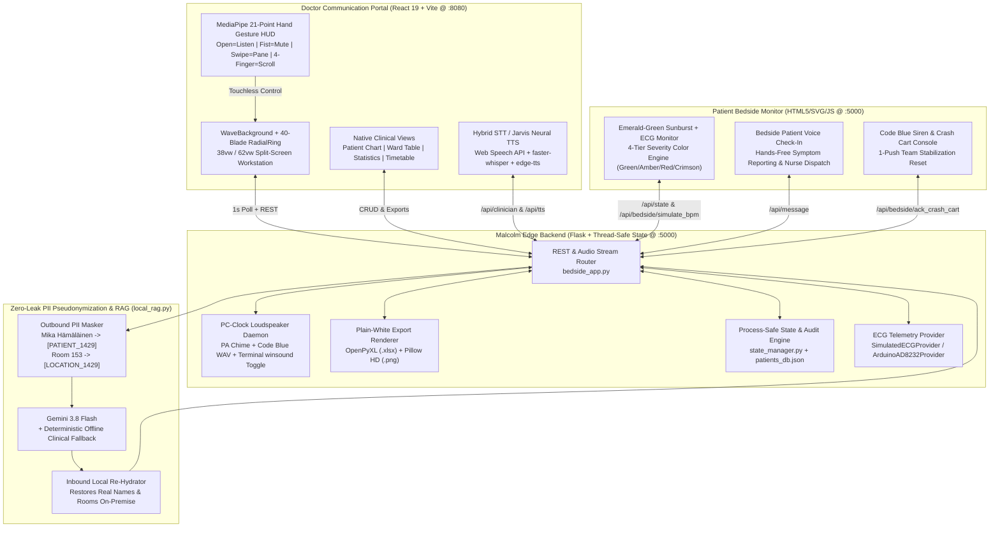

---

## Privacy-First PII Pseudonymization & Re-Hydration Pipeline

Malcolm guarantees that **Protected Health Information (PHI / PII)** never leaves the hospital's local network when querying cloud LLMs:

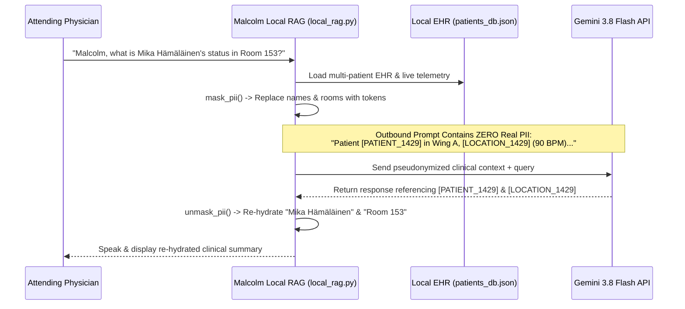

---

## Intelligent Safeguards & Native-First UI Routing

1. **Native Views First (Zero Unnecessary AI HTML Generation)**:
   - Requests for readily available clinical views (**Patient Chart**, **Ward Roster Table**, **Ward Telemetry Statistics**, and **Shift Timetable**) always route directly to their instant, type-safe native React components (`<PatientPane />`, `<WardTableView />`, `<WardStatsView />`, `<TimetableView />`).
   - Bespoke **Generative HTML/CSS (`custom_html`)** is invoked *only* when the clinician explicitly requests a custom visual comparison matrix, side-by-side protocol breakdown, or acuity heatmap—and automatically strips any interactive form tags (`<button>`, `<input>`, `<select>`, `<form>`) so the AI never fabricates fake UI buttons.
2. **Impossible-Task Refusal Guard**:
   - If asked to perform physically impossible or unsafe actions (*"Administer 10mg IV morphine"*, *"Render a 3D MRI hologram"*, *"Stream live CCTV video from Room 153"*, *"Wipe the backend server"*, *"Brew an espresso"*), Malcolm refuses with dry Jarvis wit, never opens a bogus pane, and offers a practical clinical alternative (such as dispatching a floor nurse or pulling up the patient's chart).

---

## Quick Start & Installation

### Prerequisites
- **Python 3.11+** (`pip`)
- **Node.js 18+** (`npm`)
- **Windows 10/11** (for native `winsound` PA loudspeaker synthesis and `MalcolmLauncher.exe`; macOS/Linux supported via web audio)

### 1. Clone & Install Dependencies

```powershell
git clone https://github.com/B017-12/malcolm-triage.git
cd "malcolm-triage"

# Install Python backend dependencies
pip install -r requirements.txt

# Install React Doctor Portal dependencies
npm --prefix "pixel-perfect-page-recraft" install
```

### 2. Configure Environment (`.env`)

Copy `.env.example` to `.env`:

```powershell
copy .env.example .env
```

Edit `.env` as needed:

```ini
GEMINI_API_KEY=your_gemini_api_key_here
OFFLINE_FALLBACK_MODE=False
USE_HARDWARE_ECG=False
TTS_VOICE=en-GB-RyanNeural
WINSOUND_ENABLED=True
```

> **Note:** If `GEMINI_API_KEY` is omitted or `OFFLINE_FALLBACK_MODE=True`, Malcolm runs seamlessly using its built-in **Local Deterministic Clinical RAG Engine**.

---

### 3. Launch the System

#### Option A: One-Click Windows Binary Launcher (`MalcolmLauncher.exe`)
Double-click **`MalcolmLauncher.exe`** (or run **`run_malcolm.bat`**). It automatically starts both the Flask backend (`:5000`) and React Doctor Portal (`:8080`), waits for health checks, and opens your browser.

Inside the launcher console:
- **`[R]`** — Reset demo state to clean standby
- **`[B]`** — Open Patient Bedside Monitor (`http://localhost:5000`)
- **`[C]`** — Open Doctor Communication Portal (`http://localhost:8080`)
- **`[Q]`** — Cleanly terminate all server processes

#### Option B: Run Servers in Separate Terminals

**Terminal 1 — Backend API & Patient Bedside Monitor (`http://127.0.0.1:5000`):**
```powershell
python bedside_app.py
```
*(Or launch with terminal loudspeaker muted by default: `python bedside_app.py --no-winsound`)*

**Terminal 2 — Doctor Communication Portal (`http://localhost:8080`):**
```powershell
npm --prefix "pixel-perfect-page-recraft" run dev
```

---

## Live Terminal `winsound` Loudspeaker Controls

When `python bedside_app.py` pages the doctor or fires a Code Blue alarm, it broadcasts on **both** the web portals and the host machine's physical speaker via Windows `winsound` (so the attending physician is paged even if their browser window is closed).

If you are testing both portals on the same laptop and want to prevent the terminal speaker and browser audio from overlapping, type any of these commands directly into the running `python bedside_app.py` terminal:

| Terminal Command | Effect |
| :--- | :--- |
| `winsound off` *(or `off`, `mute`, `disable`)* | Immediately disables terminal `winsound` playback so alerts play through the web portals only |
| `winsound on` *(or `on`, `unmute`, `enable`)* | Re-enables physical terminal loudspeaker paging |
| `w` *(or `toggle`)* | Toggles terminal `winsound` `ENABLED` / `DISABLED` |
| `status` | Prints current `winsound` status and available commands |

---

## Voice Commands & Hotkeys Reference

### Keyboard Shortcuts
| Shortcut | Portal | Action |
| :---: | :--- | :--- |
| **`Space`** | Doctor Portal & Bedside Monitor | Toggle continuous microphone Speech-to-Text (`LISTENING...`) |
| **`G`** | Doctor Portal | Toggle Touchless Camera Hand-Gesture HUD (`MediaPipe Hands`) |
| **`T`** | Bedside Monitor | Toggle Bedside BPM & Emergency Testing Console |
| **`R`** | Doctor Portal & Bedside Monitor | Reset all patient states, alarms, and panes back to clean `idle` standby |

### Example Clinician Voice Prompts (Doctor Portal)
- **Single-Patient Triage & Check-In**:
  - *"Malcolm, can you please give me the status of patient 1429?"* $\rightarrow$ *"Yes, him."* $\rightarrow$ *"Yes, please check in on him."*
  - *"Open the chart for Aino Virtanen."*
- **Native Ward Roster & Live Patient CRUD**:
  - *"Show me a table of all patients on the ward."*
  - *"Add a new patient named John Doe in Wing B Room 210 with chest pain at 96 BPM."*
  - *"Remove John Doe from the ward."*
- **Ward Telemetry Statistics & Bespoke Visual Matrices**:
  - *"Pull up the ward telemetry statistics."*
  - *"Create a custom side-by-side comparison matrix of all patients and their protocols."*
- **Shift Timetable & Loudspeaker Paging**:
  - *"I have a surgery at 5 PM, show my timetable and page me."*
  - *"Page me in 10 seconds."*
- **Plain-White Clinical Exports**:
  - *"Export this table as a PNG and XLSX."*
  - *"Save the ward statistics as a PNG."*

---

## Repository Structure

```text
malcolm-triage/
├── bedside_app.py                   # Flask API server, Edge-TTS/SAPI synth, PA pager daemon, XLSX/PNG exporter
├── local_rag.py                     # PII pseudonymization/re-hydration, Gemini 3.8 Flash + offline RAG engine
├── state_manager.py                 # Thread/process-safe multi-patient JSON state & CRUD manager
├── telemetry_provider.py            # SimulatedECGProvider + ArduinoAD8232Provider (HC-05 Bluetooth stub)
├── malcolm_cli.py                   # Rich terminal HUD & CLI interface for Malcolm
├── patients_db.json                 # Multi-patient EHR database (#1429 Mika, #1430 Aino, #1431 Jukka, #1432 Sanna)
├── templates/
│   └── bedside.html                 # Emerald-green Patient Bedside Monitor UI with 4-tier severity & Crash Cart
├── pixel-perfect-page-recraft/      # React 19 + TypeScript + Tailwind + Vite Doctor Communication Portal
│   └── src/
│       ├── components/malcolm/
│       │   ├── Controls.tsx         # VoiceDock, Neural TTS player, MediaPipe 21-point Gesture HUD
│       │   ├── PatientPane.tsx      # 62vw Split-Screen Chart, Ward Table CRUD, Stats, Timetable & Exports
│       │   ├── RadialRing.tsx       # 40-blade harmonic/heartbeat radial sunburst + PQRST ECG trace
│       │   └── WaveBackground.tsx   # 8-layer translucent wave ribbon canvas
│       └── lib/malcolm/
│           ├── bridge.ts            # 1s state polling, monotonic replySeq & export auto-downloader
│           ├── signal.ts            # RemoteState parser & beat envelope math
│           └── store.ts             # Reactive clinician UI state store
├── docs/
│   └── screenshots/                 # UI screenshots & gesture/bedside .gif demonstrations
├── launcher.cs                      # C# source for MalcolmLauncher.exe all-in-one binary
├── MalcolmLauncher.exe              # Standalone Windows launcher executable
└── run_malcolm.bat                  # Batch launcher script
```
